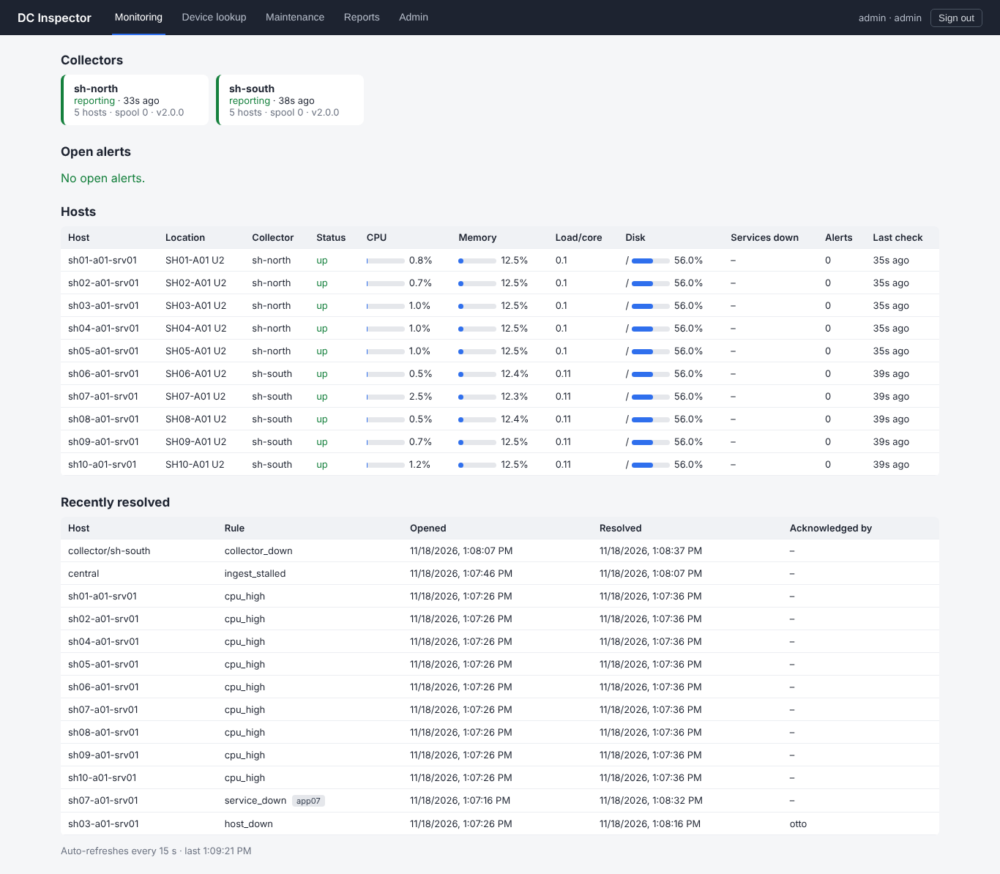
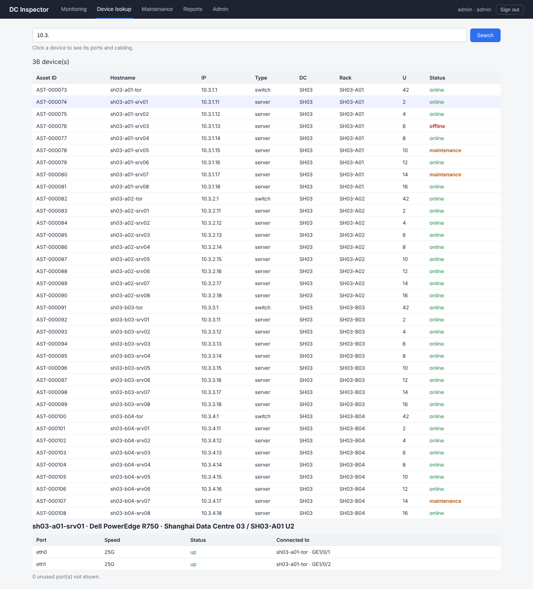
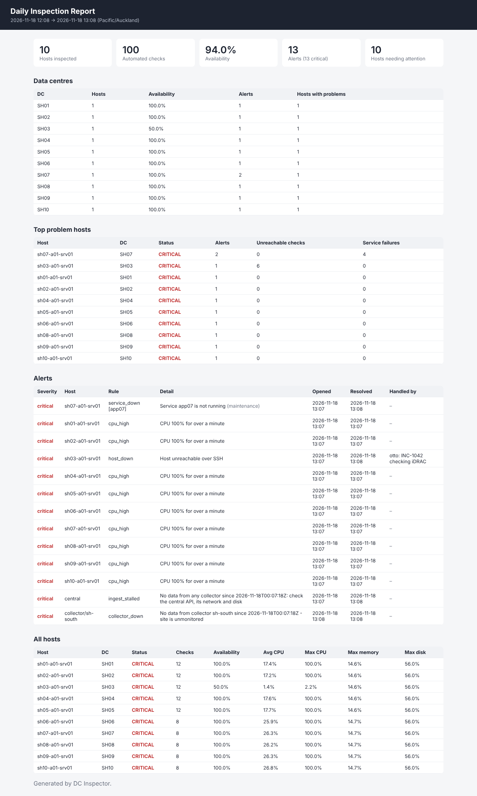
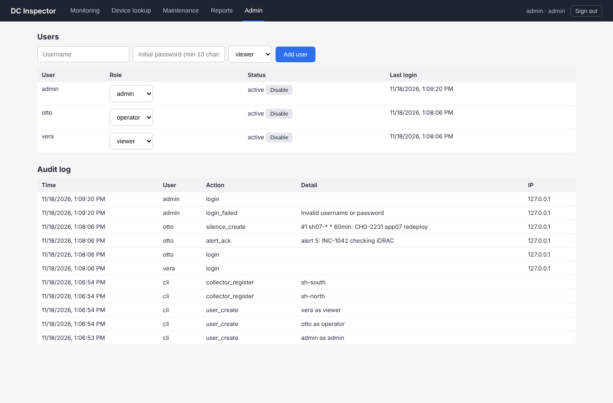

# DC Inspector

Agentless data-centre inspection, alerting and device lookup for multi-site server fleets.

A personal re-implementation of an internal tool I built as a junior engineer at VNET (2021–2022),
rebuilt from scratch and extended to a production-style architecture. All data is mock data;
no company code or data is used.

| Monitoring | Device lookup | Daily report | Admin & audit |
|---|---|---|---|
|  |  |  |  |

*Screenshots from a real run: 10 SSH hosts, 2 site collectors, central server and scheduler as separate
processes, with a host failure, a killed service, CPU stress, a central outage and a collector outage.*

## Architecture

```
  site-north network                       mgmt network                       site-south network
 ┌──────────────────────┐               ┌──────────────────────┐               ┌──────────────────────┐
 │ sh01 … sh05 (SSH)    │◀── SSH ──┐    │  central             │    ┌── SSH ──▶│ sh06 … sh10 (SSH)    │
 └──────────────────────┘          │    │  ├ web UI + API      │    │          └──────────────────────┘
                          ┌────────┴──┐ │  ├ ingest (token)    │ ┌──┴────────┐
                          │ collector │─┼─▶├ alert engine      │◀┼─│ collector │
                          │ sh-north  │ │  └ SQLite (WAL)      │ │ │ sh-south  │
                          │  + spool  │ │  scheduler           │ │ │  + spool  │
                          └───────────┘ │  ├ notifications ────┼─┼─▶ email / WeCom / DingTalk / Slack
                                        │  ├ watchdog          │ │
                                        │  └ daily report      │ │
                                        └──────────────────────┘
```

- **Agentless**: nothing is installed on inspected hosts — one SSH command per host per round reads
  `/proc`, `df` and process state. Works on any Linux, including minimal images without systemd.
- **One collector per site**, next to its hosts. The central server never connects to hosts;
  collectors only push outbound HTTPS — a realistic firewall/segmentation model.
- **Store-and-forward**: every batch goes to a local spool first. If the central server or the WAN
  link is down, data is kept and delivered later. The server de-duplicates re-sent data
  (`UNIQUE(host, collected_at)`), so retries are always safe.
- **Central configuration**: interval and custom checks are defined once on the server and pulled by
  every collector.

## Features

**Inspection** — CPU, memory, swap, load per core, disk and inode usage per mount, service status,
plus **custom checks** defined centrally (command + optional regex), e.g. zombie processes, uptime
(reboot detection), port 80 listening, filesystems remounted read-only.

**Alert rules as expressions** (`config/rules.yaml`, safe parser — no `eval`):

```yaml
- name: disk_warning
  expr: disk.*.percent > 85 and disk.*.percent <= 95   # one alert per mount
  severity: warning
  summary: "Disk {target} {value:.0f}% full"
- name: cpu_high
  expr: cpu.percent > 90
  for: 2                                               # 2 checks in a row (~1 min): ignores spikes
  severity: critical
```

**Alert lifecycle** — one alert per host + rule + target; opened once, updated while it continues,
resolved automatically. Missing data never resolves an alert (an unreachable host is not "fixed").
Operators **acknowledge** alerts (stops reminders) and open **maintenance windows** (alerts are still
recorded but not notified). Unacknowledged critical alerts are **re-notified** every 30 min.

**Outage-aware** — after an outage, spooled rounds are replayed in order and evaluated at the time
they were collected, so a problem that started and ended during the gap is still recorded with the
right times. If one site goes silent → `collector_down` for that site; if *every* site goes silent
at once → a single `ingest_stalled` alert on the central server instead of blaming every site.

**Notifications** — email (SMTP), 企业微信 WeCom robot, 钉钉 DingTalk robot (HMAC-signed), Slack.
Routing by severity and data centre. Sent from an **outbox** with exponential-backoff retries, so a
slow mail server never blocks ingest and nothing is lost on restart. Every alert carries its rack
location (`SH03-A01 U2`) from the inventory, so on-site staff know where to go.

**Access control** — roles `viewer` / `operator` / `admin`; hashed passwords, lockout after 5 failed
logins, generic login errors, 8-hour sessions, JSON-only writes (CSRF), and an **audit log** of logins,
acknowledgements, maintenance windows and user changes. Collectors authenticate with per-site API
tokens (stored as SHA-256 hashes, rotatable).

**Device lookup (CMDB)** — 10 data centres, 40 racks, 360 devices. One search box for IP, IP prefix,
rack, data centre or asset ID; device page shows every port and what it is cabled to.

**Daily report** — availability per data centre, top problem hosts, every alert with who handled it,
per-host CPU / memory / disk. Emailed to channels with `daily_report: true`. Data retention built in.

## Run the full topology (Docker)

```bash
cp .env.example .env          # set admin password, secret key, two collector tokens
docker compose up --build     # 10 hosts, 2 collectors, central, scheduler
```

Open http://localhost:8000 and sign in as `admin`. Hosts use **SSH keys only** (generated by a
one-off `keygen` service); each collector only reaches its own site network.

### Break things

```bash
docker compose stop sh03-a01-srv01                                   # host_down (~1 min)
docker compose exec sh04-a01-srv01 pkill nginx                       # service_down (next check)
docker compose exec sh05-a01-srv01 stress-ng --cpu 0 --timeout 180s  # cpu_high
docker compose exec sh06-a01-srv01 dd if=/dev/zero of=/data/f bs=1M count=58   # disk_warning on /data
docker compose stop central         # collectors spool; scheduler raises ingest_stalled
docker compose start central        # spool is flushed, history back-filled
docker compose stop collector-south # collector_down for sh-south only
```

## Deploy on real servers

- `deploy/ansible/` — playbook with roles for the central server, the site collectors, and the
  inspected hosts (creates a no-password, no-sudo `inspector` account and installs the site
  collector's key with `no-pty,no-port-forwarding`). Secrets come from Ansible Vault.
- `deploy/systemd/` — hardened units (`ProtectSystem=strict`, `NoNewPrivileges`) for web,
  scheduler and collector. Put the web service behind a TLS reverse proxy.
- On systemd hosts set `service_check: "systemctl is-active {name}"`; pin host keys with `known_hosts`.

## Development

```bash
python -m venv .venv && source .venv/bin/activate
pip install -r requirements.txt
python -m pytest                                   # 174 tests
python -m inspector.main init                      # schema + mock inventory
python -m inspector.main create-user me --role admin
python -m inspector.main server                    # http://127.0.0.1:8000
```

CLI: `init | create-user | add-collector | server | scheduler | report | check-config | agent | collect-once`

## Design decisions and trade-offs

- **Why not Prometheus + node_exporter?** The original environment did not allow installing agents
  on customer-facing servers, and alerts had to carry physical rack locations from the CMDB.
  The rule syntax (`expr`, `for`) deliberately follows Prometheus conventions.
- **SQLite** keeps the project dependency-free; WAL mode lets the web app read while ingest writes,
  and `BEGIN IMMEDIATE` serialises alert evaluation across web workers. WAL needs a local disk
  (not a network share). At larger scale: PostgreSQL for state, a time-series store for samples —
  the SQL and data model are portable.
- **One SSH session per host per round**, parallel per site, bounded by timeouts: a dead host never
  delays the others. Two SSH backends: system `ssh` (keys, reuses ssh config) or paramiko.
- **Safety**: service names and mount paths are validated and shell-quoted; custom check commands
  can only be defined in the server config file (by admins), never via the UI or API; ingest
  validates every field and rejects timestamps from the future (clock skew).

## Project layout

```
inspector/
  parsers.py    remote command + parsing into flat metrics      expr.py      safe rule expression language
  collector.py  parallel SSH collection                         rules.py     rule definitions/evaluation
  agent.py      site collector: config pull, spool, send        alerts.py    alert lifecycle, silences, watchdog
  ingest.py     validation, idempotent storage, replay          notify.py    routing, outbox, channel senders
  app.py        web UI + REST API + collector API               auth.py      users, roles, tokens, audit
  scheduler.py  delivery, watchdog, reminders, daily report     report.py    HTML report, retention
  lookup.py     CMDB search and cabling                         seed.py      mock inventory
config/         server.yaml, rules.yaml, collectors/*.yaml
docker/         host image (sshd, nginx, stress-ng), central bootstrap
deploy/         ansible/, systemd/
tests/          174 pytest tests
```

Python 3.10+ · Flask · SQLite · OpenSSH / paramiko · Jinja2 · pytest · Docker Compose · Ansible · systemd
